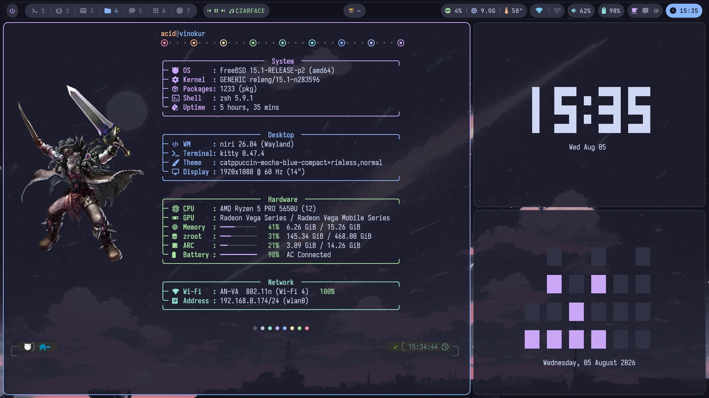
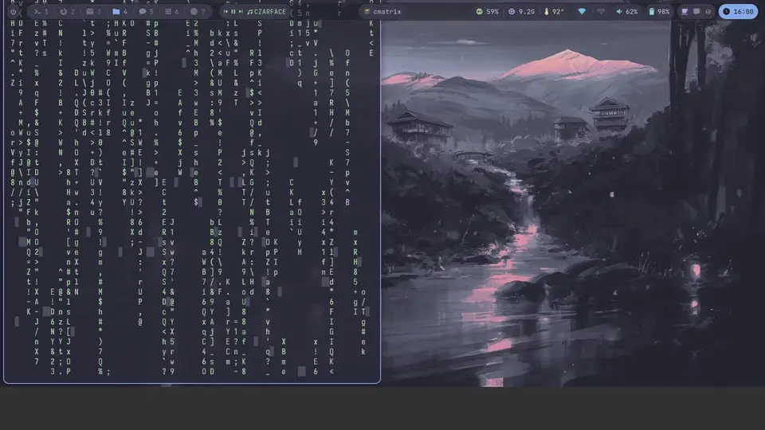
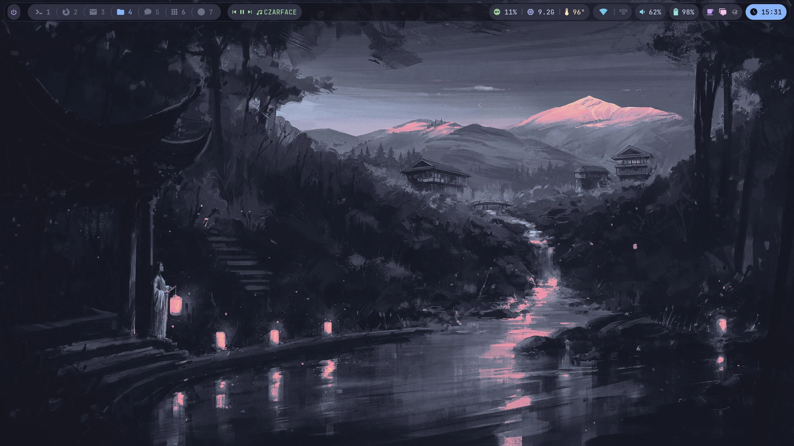
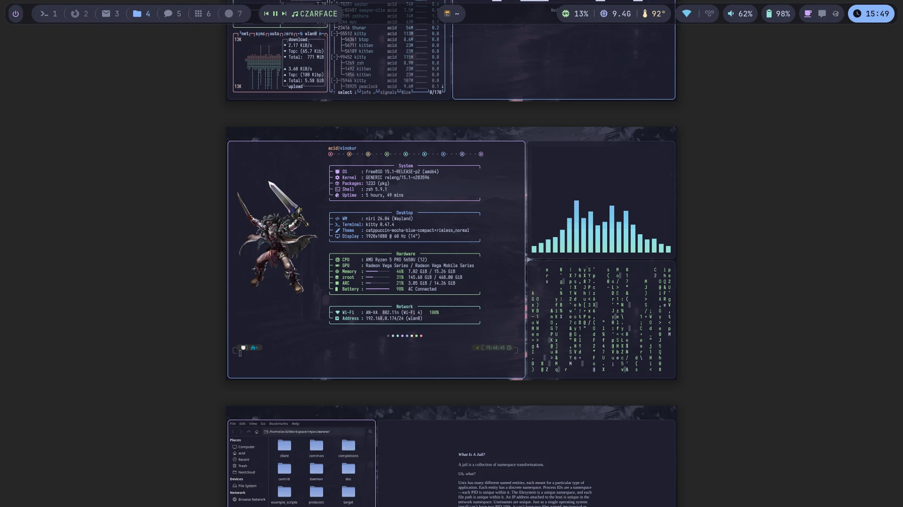
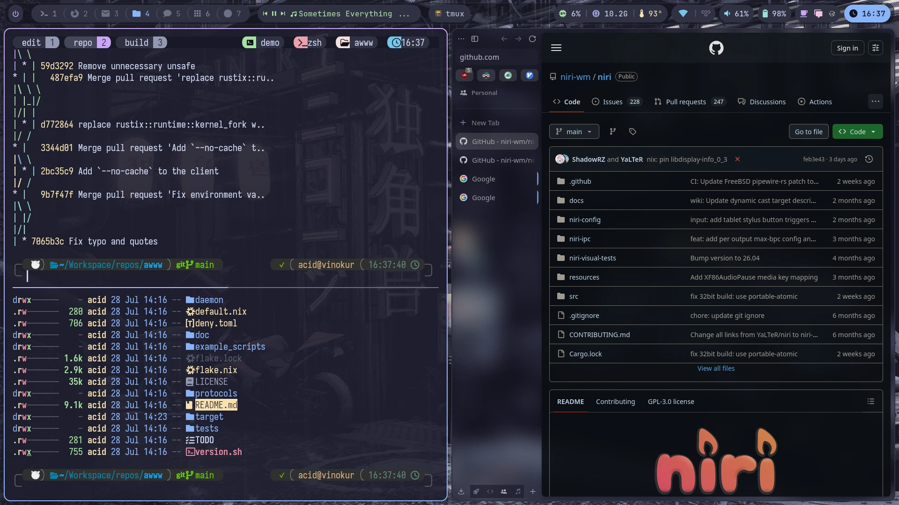
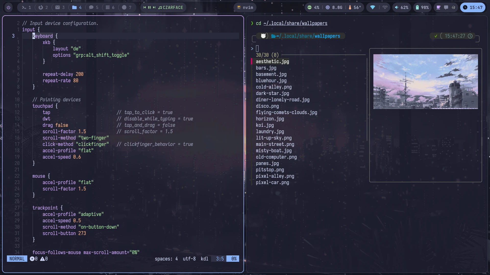
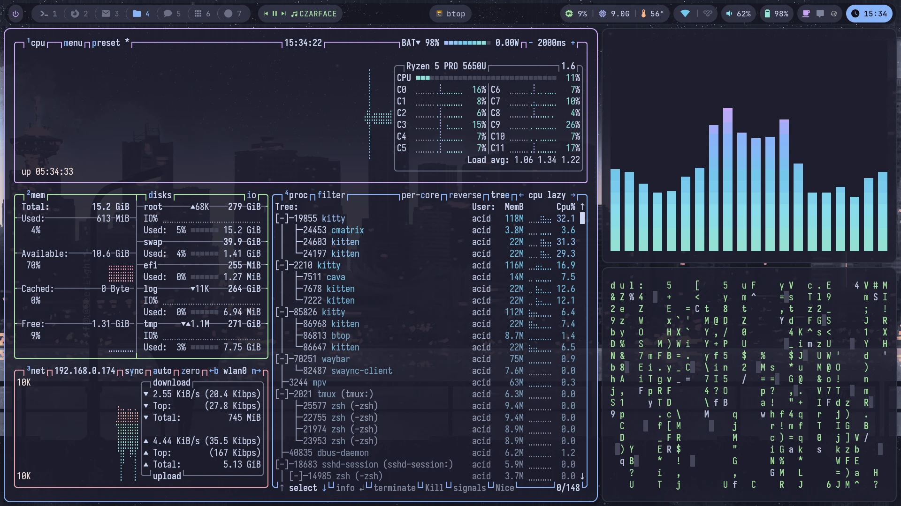
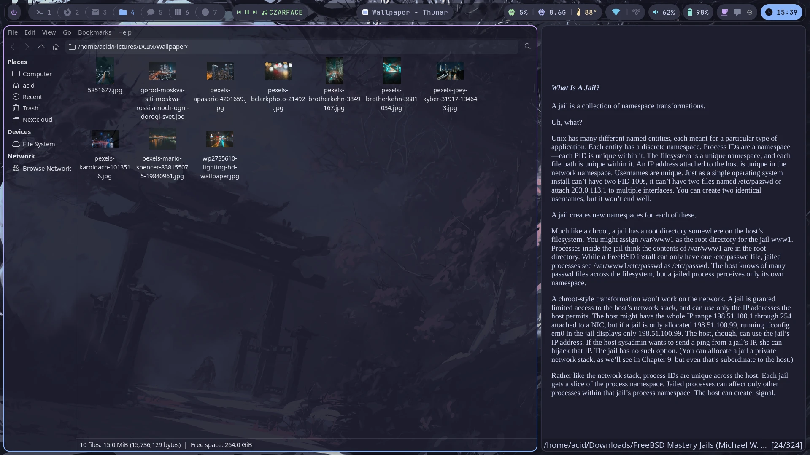
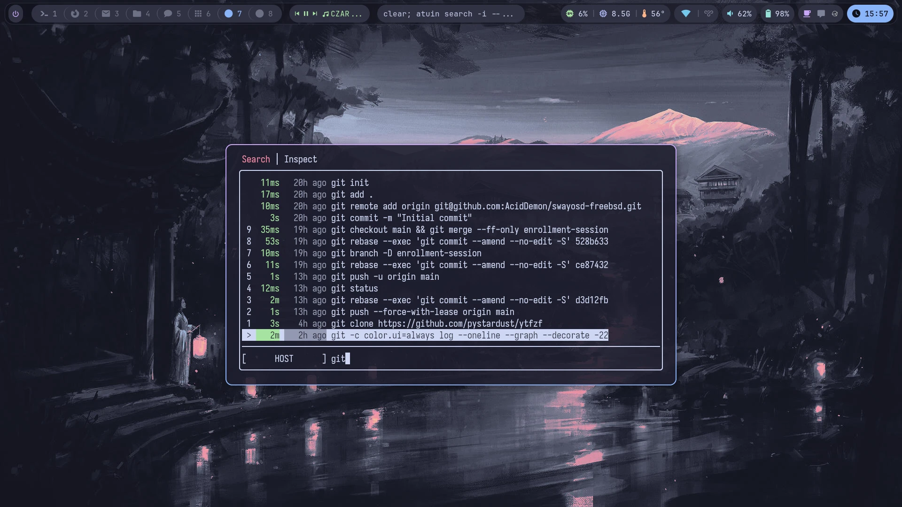
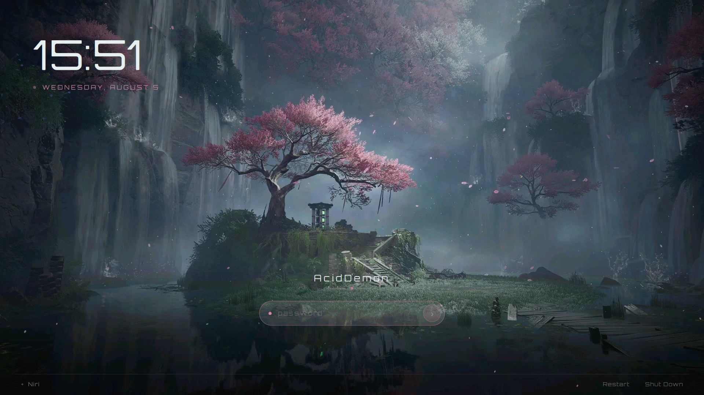

# dotfiles

FreeBSD workstation config, managed with [chezmoi](https://chezmoi.io).
Desktop is **niri** (scrolling Wayland compositor) launched from **sddm**, with a
**Quickshell** shell, hypridle and awww. Fifteen base16 themes switch live with
`theme-switch`; Catppuccin Mocha is the default.

Most of this is ordinary dotfiles. The niri-under-sddm part is not: FreeBSD needs
three fixes that no guide mentions, and each one presents as an identical black
screen. They are automated here — the table below exists so that if it ever
breaks again, you recognise the symptom instead of re-debugging it from scratch.



fastfetch builds the ZFS ARC and zpool bars by hand out of `sysctl
kstat.zfs.misc.arcstats`; the logo is a kitty graphics image, so it renders in
kitty and nowhere else. Alongside it, peaclock in both of its configs — digital
from `~/.config/peaclock`, binary from `~/.config/peaclock-binary`, selected with
`--config-dir`.

## The desktop



Columns scroll horizontally rather than packing into a fixed grid, so opening a
window never resizes the one you are reading. The clip runs the four column-width
presets, the tabbed-column display (IPC-only — there is no keybind for it), a
workspace switch, the overview, rofi, and a notification arriving. The full
1080p60 recording is attached to the [latest release](../../releases/latest);
only the loop above is tracked, for the same reason the wallpapers are not.

The clip and the screenshots below predate the switch to Quickshell, so the bar
in them is the old waybar.

### Windows

| | |
|---|---|
| <br>An empty workspace. | <br>`Mod+O`. Workspaces stack vertically. Stock niri zoom; there is no `overview` block in the config, which is why roughly two fit on screen. |
| <br>Zen — not in ports, built separately — beside tmux. Zen's window rule sets `xray true`, so its blur samples the *wallpaper*, not the windows behind it. | <br>neovim on the niri config, and fzf's `Ctrl+T` widget previewing an image inline over the kitty graphics protocol. |
| <br>btop at 2/3, cava and cmatrix stacked in the remaining third. | <br>Thunar and zathura. `recolor` is on in `zathurarc`, which is why the page is Mocha and not white; `r` toggles it. |

### The shell

`quickshell -c desktop`, started by niri, runs the bar, the launcher, the
notification centre and its popups, the volume and brightness OSD, the power menu
and the theme and wallpaper switcher. The lock screen is a separate process,
started by `qs-lock`, so restarting the shell cannot unlock the session. The QML
in `private_dot_config/private_quickshell/private_desktop/` is a fork of
`nixfiles/modules/desktop/quickshell/config`. Every place where it differs is
marked `// freebsd:`, so changes in nixfiles can be merged by hand. `ponytail:`
marks known shortcuts.

The fork differs where FreeBSD lacks the Linux piece:

- Audio is PulseAudio through `pactl`. There is no PipeWire server.
- Wi-Fi state comes from `ifconfig` (`qs-net`). The Wi-Fi tile toggles the interface
  through `airplane-toggle`, and the VPN tile runs `tailscale up` / `tailscale down`.
- Battery, temperature, memory, CPU and backlight come from sysctl, `backlight(8)`
  and `/compat/linux/proc`, through the `qs-*` scripts in `bin/`. devd events
  refresh the battery and backlight readings.
- There is no Bluetooth tile (no BlueZ). The power menu has no Suspend or
  Hibernate, because this firmware offers only S4/S5 and has no S3.
- The lock screen authenticates through `/usr/local/etc/pam.d/unix-selfauth`, the
  same stack hyprlock used.

| Key | Does |
|---|---|
| `Mod+D`, `Mod+Y`, `Mod+Period`, `Mod+Comma` | launcher: apps, clipboard, emoji, calculator. Windows is a tab in it |
| `Mod+N`, `Mod+W` | notification centre, do not disturb |
| `Mod+Shift+W` | theme and wallpaper switcher |
| `Mod+Escape`, `Super+Alt+L` | lock |
| volume, mic and brightness keys, `Mod+Shift+M` | change the level, then show the OSD (`qs-osd`) |

The power menu opens from the button on the bar. niri starts the shell under
`daemon -r -R 2`, which restarts it 2 seconds after it exits, as the systemd unit
does on NixOS. So `quickshell kill -c desktop` is a restart. When niri is gone, the
next start finds no niri and ends the supervisor, so a logout leaves nothing behind.
`pkill -f 'daemon: quickshell-desktop'` stops it for good. Do not use
`pkill quickshell`: it also kills the lock screen.

`run_onchange_after_build-quickshell-shaders.sh.tmpl` compiles the switcher's
shaders with `qsb` whenever their sources change. The JS has tests:
`node private_dot_config/private_quickshell/.tests/parse-check.js` and
`node private_dot_config/private_quickshell/.tests/ring.test.mjs`.

### Themes and wallpapers

`theme-switch <id>` re-themes everything at once. The ids are the keys of
`~/.config/theming/themes.json`, the same fifteen themes as
`nixfiles/modules/theming/colorscheme/themes.nix`. The switcher (`Mod+Shift+W`)
lists them too. The active id is in `~/.local/state/theming/current`. With no
state file, everything renders Catppuccin Mocha.

A file is themed when its chezmoi template calls `includeTemplate "theme"`.
`theme-switch` finds those templates itself and re-renders them with
`THEME_ID=<id> chezmoi apply --force`. It then writes
`~/.local/state/theming/palette.json` and `current`, reloads kitty, tmux and GTK, and
sets a wallpaper from the new theme's pool. Quickshell and neovim pick up the change
on their own. Zen picks it up on its next start, through the root-owned
`/usr/local/sbin/zen-theme-sync`. To preview a theme without switching, run for
example `THEME_ID=nord chezmoi cat ~/.config/kitty/theme.conf`.
`run_onchange_after_write-palette.sh.tmpl` writes `palette.json` on `chezmoi apply`
as well, as NixOS does on activation: on the first apply, and after every change to
`themes.json`.

`--force` means a switch overwrites every themed file without asking, the same as
the read-only store files on NixOS. That includes the whole niri `config.kdl`,
`qt5ct.conf` and `qt6ct.conf` (which the qt5ct/qt6ct GUIs rewrite), the GTK
`settings.ini` files and `kvantum.kvconfig`. A change made in the live file, by hand
or by a settings GUI, is lost at the next switch. Make it in the chezmoi source
(`chezmoi edit ~/.config/niri/config.kdl`) and apply it.

```sh
wallpaper apply                      # the theme's remembered pick, or a random one while shuffling
wallpaper pick <image> [output]      # set one image and remember it
wallpaper list <output> <theme>...   # the pool, as the switcher shows it
wallpaper shuffle on|off|status      # rotate on a timer, or keep the pick
wallpaper interval [seconds]         # rotation interval, default 900
```

Each theme has its own pool, `~/.local/share/wallpapers/themes/<id>/`
(`WALLPAPER_DIR` in `~/.config/awww/rotate.conf`). `apply` on an empty pool keeps the
current wallpaper. `wallpaper daemon`, started by niri, rotates through the pool once
per interval while shuffle is on, and rereads the active theme on every tick. Shuffle
is off on a new machine, so the first random pick stays until you run
`wallpaper shuffle on` (the old `awww-random` always rotated).

### The drop-down terminal



`F12`. `private_dot_config/private_niri/scripts/quake.sh` never closes the window
— it slides it to `y=-2000` and parks it on the `scratch` workspace, so the shell
and everything running in it survive. The slide is niri's own `window-movement`
animation, which is why the script's `SLIDE` constant is tuned against
`slowdown 1.8` and desyncs if you change it.

### Login and lock



Session picker bottom-left — that is the `niri.desktop` entry the setup script
keeps repairing after every `pkg upgrade niri`.

hypridle dims the backlight after 5 minutes, locks with `qs-lock` and arms
`shutdown-timer` after 10, and turns the monitors off after 20.

If the locker dies or hangs, niri keeps the session locked (ext-session-lock: a
dead locker never unlocks) and accepts a new locker in its place. Recover from a text
console:

1. `Ctrl+Alt+F2` (it works while locked, through the `vtswitch` rule under
   "Optional" below) and log in. Over SSH works the same.
2. Start a new locker against the running niri. A console login has
   `XDG_RUNTIME_DIR=/tmp/xdg-$USER` from `.zprofile` but no `WAYLAND_DISPLAY`; niri
   logs its socket name (`wayland-1` so far) to `~/.local/share/niri.log`:

   ```sh
   pkill -9 -f desktop/lock.qml   # a hung locker still counts as alive and holds qs-lock's lockf
   export WAYLAND_DISPLAY=$(grep -a 'listening on Wayland socket' ~/.local/share/niri.log | tail -1 | sed 's/.*: //')
   QT_QPA_PLATFORM=wayland qs-lock
   ```

3. Switch back with `Alt+F7`, `F8` or `F9`, whichever shows the lock screen (sddm
   puts the session on the first free VT from 7 up), and unlock with your password.

If the password is refused there too, check that `/usr/local/etc/pam.d/unix-selfauth`
exists (`doas pkg install unix-selfauth-helper`, then step 2 again). As a last resort,
end the session from the console. Open windows are lost:

```sh
export NIRI_SOCKET=$(grep -a 'IPC listening on' ~/.local/share/niri.log | tail -1 | sed 's/.*: //')
niri msg action quit --skip-confirmation
```

## Fresh machine

```sh
pkg install -y chezmoi
chezmoi init --apply <this-repo>
```

`run_after_setup-niri-session.sh` runs automatically on every `chezmoi apply` and
is idempotent — it does nothing when everything is already correct. It will:

- install missing packages (niri, seatd, sddm, dbus, cage, quickshell, python3, the
  fonts the shell names, …) and mark them non-automatic, so `pkg autoremove` keeps
  them
- set `dbus_enable` / `seatd_enable` / `sddm_enable` in `rc.conf`
- add you to the `video` group (seatd refuses device access without it)
- detect your GPU and put the right DRM driver in `kld_list`
- install `/usr/local/bin/niri-session` and point the session file at it

It re-checks the session file every run on purpose: `pkg upgrade niri` overwrites
`niri.desktop` and silently reverts `Exec=`, which breaks the session with no
obvious cause.

The shader and Kvantum scripts sort before it, so on a fresh machine they find no
`qsb` or `python3` yet, skip with a message, and run on the next `chezmoi apply`.

Then reboot, pick **Niri** at the greeter, and log in.

## The three FreeBSD gotchas

| Symptom | Cause | Fixed by |
|---|---|---|
| niri panics creating its Wayland socket | sddm calls `pam_close_session` right after *starting* the session, so `pam_xdg` deletes `/var/run/xdg/$USER` while the compositor is still coming up | `XDG_RUNTIME_DIR` override to `/tmp/xdg-$USER` in `.zprofile` / `.profile` |
| waybar dead, niri logs `import environment ... exit status: 71` | sddm provides no D-Bus **session** bus | `dbus-launch` in `niri-session` |
| session dies ~1s in; niri keeps running orphaned and the greeter never comes back | seatd sends a **real-time signal** to the session leader when it takes the VT; unhandled RT signals terminate by default | RT signals ignored in `niri-session` |

Two things that actively mislead while debugging, worth knowing:

- `wayland-server` reports **every** failure opening its socket lock as
  `PermissionDenied` (`map_err(|_| PermissionDenied)`), so the real errno —
  `ENOENT` — is thrown away. `dtrace` on `openat` is what found it.
- `pam_xdg(8)` claims it does not set `XDG_RUNTIME_DIR`. It does. An
  `if [ -z "$XDG_RUNTIME_DIR" ]` guard therefore never fires; the override has
  to match on the *value*.

## Optional, not applied automatically

These grant passwordless root for specific commands, so opt in deliberately:

```sh
# ~/bin/shutdown-timer, to power off unattended after idle-lock.
# /sbin/shutdown is setuid root, group operator, so joining it is enough. Without
# it, shutdown-timer falls back to the /sbin/shutdown -p now rule below.
doas pw groupmod operator -m "$(id -un)"

# ~/bin/airplane-toggle and the Wi-Fi tile. Add AFTER any general permit line in
# /usr/local/etc/doas.conf -- doas uses the LAST matching rule.
permit nopass <user> as root cmd /sbin/ifconfig args wlan0 up
permit nopass <user> as root cmd /sbin/ifconfig args wlan0 down

# Reboot and Shutdown in the power menu (~/bin/qs-systemctl). The shell runs
# them without a tty, so a password prompt cannot work.
permit nopass <user> as root cmd /sbin/shutdown args -r now
permit nopass <user> as root cmd /sbin/shutdown args -p now

# Zen follows theme-switch. Install the repo copy first:
#   doas install -m 755 -o root -g wheel \
#       private_dot_config/private_theming/private_zen/.zen-theme-sync \
#       /usr/local/sbin/zen-theme-sync
permit nopass <user> as root cmd /usr/local/sbin/zen-theme-sync

# Ctrl+Alt+F1..F6 in niri (~/.config/niri/config.kdl), also on the lock screen:
# /usr/local/sbin/vtswitch stops keyd so the text console gets a keyboard.
permit nopass <user> as root cmd /usr/local/sbin/vtswitch

# The VPN tile (~/bin/qs-vpn-toggle) drives WireGuard with wg-quick once
# /usr/local/etc/wireguard has configs, and Tailscale (as you, not root) until then.
permit nopass <user> as root cmd /usr/local/bin/wg-quick
doas tailscale set --operator="$(id -un)"

# Caps/Num Lock OSD. /dev/input/event* is root-only, so a small root service
# publishes just the two LED bits in /var/run/kbdleds (like /sys/class/leds on Linux).
q=private_dot_config/private_quickshell/.system
doas install -m 755 -o root -g wheel $q/kbdleds /usr/local/libexec/kbdleds
doas install -m 755 -o root -g wheel $q/kbdleds.rc /usr/local/etc/rc.d/kbdleds
doas sysrc kbdleds_enable=YES && doas service kbdleds start
```

doas compares a rule's `cmd` with the command exactly as it was typed, so every
caller above uses the absolute path.

Keep a root shell open while editing `doas.conf`; a syntax error there locks you
out of escalation entirely. Check with `doas doas -C /usr/local/etc/doas.conf`.

## Where things live

| Path | What |
|---|---|
| `bin/private_executable_niri-session` | session wrapper → `/usr/local/bin/niri-session` |
| `run_after_setup-niri-session.sh` | system-side setup, every apply |
| `run_once_after_build-awww.sh` | builds the awww wallpaper daemon (not in ports) |
| `run_once_after_install-themes.sh` | Colloid icons + WhiteSur cursors (583M, built not tracked) |
| `run_onchange_after_install-crontab.sh` | the whole user crontab (qutebrowser adblock refresh); `crontab -e` edits get overwritten |
| `private_dot_config/private_niri/` | compositor config |
| `private_dot_config/private_quickshell/private_desktop/` | the shell, forked from the nixfiles QML |
| `bin/executable_qs-*` | the scripts between the shell and FreeBSD: sysctl, pactl, ifconfig, doas |
| `bin/executable_theme-switch`, `bin/executable_wallpaper` | theme and wallpaper switching |
| `private_dot_config/private_theming/private_themes.json`, `.chezmoitemplates/theme` | the theme data, and the partial every themed template includes |
| `run_onchange_after_build-quickshell-shaders.sh.tmpl` | compiles the switcher shaders |
| `run_onchange_after_kvantum-recolour.sh.tmpl` | builds a Kvantum theme for each base16 theme |
| `run_onchange_after_write-palette.sh.tmpl` | writes `~/.local/state/theming/palette.json` for the active theme |
| `.chezmoiremove` | live targets of removed sources (waybar, swaync, rofi, hyprlock, …) that `chezmoi apply` deletes |
| `private_dot_zprofile`, `private_dot_profile` | the `XDG_RUNTIME_DIR` fix |
| `private_dot_local/private_share/private_tools/` | the twelve self-written CLI tools, one directory each |
| `bin/symlink_*.tmpl` | `~/bin/<tool>` → the script in that directory |

Wallpapers are deliberately **not** tracked (`.chezmoiignore`) — 32M of images do
not belong in git history. Put your own in
`~/.local/share/wallpapers/themes/<theme id>/`.

## The tools tree

`cam cheat clone ebook2audio myip open px scratch search urlencode web-noise yank`
are the same scripts as `nixfiles/pkgs/<name>/`, where they are packaged with
`writeShellApplication`. Here they are plain files: `~/.local/share/tools/<name>/`
holds the script, and `bin/symlink_<name>.tmpl` puts a link in `~/bin`, which
`/etc/login.conf` already has on `PATH`. The single-file scripts in `bin/` stay flat
— a directory per file buys nothing.

Each directory keeps its `default.nix` alongside the script so the packaging and the
code travel together. Those, and web-noise's `setup.py`/`LICENSE`/`README.md`/
`USAGE-NIXOS.md`, are listed in `.chezmoiignore`: repo-only, never deployed. The bare
`README.md` entry higher up matches only the top level, hence web-noise needs its own
line.

The two copies are meant to stay byte-identical, so drift is one command:

```sh
for d in cam cheat clone ebook2audio myip open px scratch search urlencode yank; do
    diff "$REPOS/github.com/AcidDemon/nixfiles/pkgs/$d/$d.sh" \
         "private_dot_local/private_share/private_tools/private_$d/executable_$d.sh"
done
```

`cam` and `ebook2audio` deploy but are inert here — no `scrcpy`, no v4l2, no
`calibre`, no `piper`. Both check their dependencies up front and say so. `myip` uses
base `drill` when `dig` is absent, so it needs no port. `web-noise` wants
`-c` pointed at a copy of `config.example.json`.

## Identity

Addresses, real name, handles, the Syncthing device table and the private half of
`~/.ssh/config` live in two encrypted blobs at the source root: `.identity.toml.asc`
(gpg, to both YubiKey encryption subkeys) and `.identity.toml.age` (passphrase, for a
machine with no card). `.chezmoi.toml.tmpl` probes `gpg --card-status` at `chezmoi init`
and points `.identity` at whichever one this machine can open.

The blob is decrypted exactly once, by `.chezmoi.toml.tmpl` during `chezmoi init`, and
spliced into `[data]` in the generated `~/.config/chezmoi/chezmoi.toml`. Everything after
that — `apply`, `diff`, `cat`, `status` — reads plain config data and never touches the
card. Templates just say `{{ $id := . }}` and use `$id.mail.accounts` and friends.

Doing it per-template instead is what the first cut did, and it is unusable: 17 templates
means 17 `app_decipher` calls per chezmoi command, faster than pinentry can resolve them,
so the PIN prompt loops forever.

Edit with `./.identity-edit`, then re-run `chezmoi init` to reload. The script decrypts,
opens `$EDITOR`, and re-encrypts **both** blobs from the same plaintext so they cannot
drift. `./.verify` checks that.

There is deliberately no `default` fallback in those templates. With neither card nor
passphrase the apply aborts before writing anything. The GECOS field is a real name, so
a half-configured neomutt would quietly sign mail as `$(id -un)@$(hostname)` rather
than fail.

## Not in the repo

Restoring these by hand is part of setting up a new machine:

| Path | What |
|---|---|
| `~/.ssh/*_ed25519`, `*-borgbackup-ssh`, `*-restic-ssh` | the keys themselves. Only `config` is tracked |
| `~/.local/state/syncthing/` | device identity — a new `key.pem` means a new device ID and re-pairing everywhere |
| `~/.local/share/atuin/key` | history encryption key. Note `auto_sync` is on but there is no session file, so sync is **not** running — `history.db` is the only copy |
| `~/.config/gh/hosts.yml`, `~/.config/keepassxc/`, `~/.config/weechat/sec.conf`, `~/.config/syncthingtray.ini` | tokens, keys, passwords |
| the YouTube login in Zen | `yt-dlp` reads cookies straight out of Zen's profile rather than a `cookies.txt`, so there is no credential to restore — but there is also nothing to download with until you sign in. Deliberate: session cookies are bearer tokens that bypass 2FA *and* they rotate, so tracking them even encrypted would leave a fresh ciphertext in git history every refresh |
| the YubiKeys | without one, nothing above decrypts and the age passphrase is the only way in |

Syncthing device IDs and folder paths are in the identity blob under `[sync]`, so a
rebuild is a checklist rather than archaeology. All three folders are `receiveonly`.
